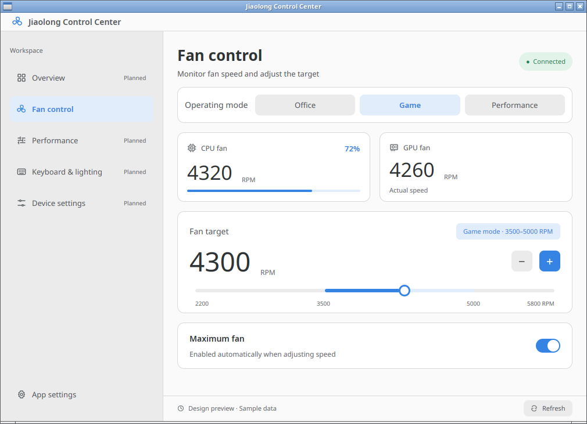
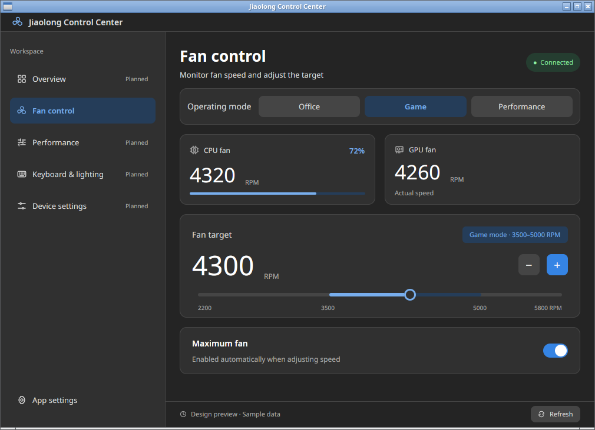

# Jiaolong Control

A Rust/GPUI fan-control app for Jiaolong laptops on Linux, using the original MiInterface firmware protocol (WMI GUID `B60BFB48-3E5B-49E4-A0E9-8CFFE1B3434B`).

- Live CPU/GPU fan speeds and Office / Game / Performance mode selection.
- Fixed 2200–5800 RPM slider with mode limits, 100 RPM buttons, and saved per-mode targets.
- Maximum-fan switch, Adwaita light/dark/system themes, and Chinese/English UI.
- System fontconfig fonts; GPUI pinned to the variable-font weight fix in [PR #62832](https://github.com/zed-industries/zed/pull/62832).

## Screenshots

Light and dark themes (preview data):




## Build and run

Requires Rust, GCC, Make, matching kernel development headers, and Wayland or X11. Fedora graphics dependencies: `libxkbcommon-devel libxkbcommon-x11-devel wayland-devel fontconfig-devel`.

```bash
cargo build --release --locked
./scripts/install-driver.sh
./target/release/jiaolong-control
```

The installer uses sudo to install the firmware-access module and udev rule. Re-run it after kernel updates. Close the app before replacing a loaded module or running `./scripts/uninstall-driver.sh`.

Preview with sample data:

```bash
./target/release/jiaolong-control --preview-ui=light,settings,en
./target/release/jiaolong-control --preview-ui=dark
```

App preferences live in `$XDG_CONFIG_HOME/jiaolong-control/preferences.json` (default `~/.config/jiaolong-control/`). Fan targets use the original `AppMachineInfo` format in the same configuration directory; existing files beside the executable are imported when the user file is absent. Mode switching follows the original Type-C power restriction.

## RPM / DEB packages

Download packages from [Releases](https://github.com/zhzy0077/jiaolong-control/releases).

```bash
python3 packaging/build.py rpm
python3 packaging/build.py deb
```

Packages include a DKMS module installed by their post-install scripts. See [packaging/](packaging/) for dependencies and installation.

## Tests

```bash
cargo test --locked
cargo clippy --all-targets --locked -- -D warnings
```

Tests cover firmware request vectors, mode limits, slider mapping, preferences, and variable-font weights. Editable UI mockups are in [`design/`](design/).
